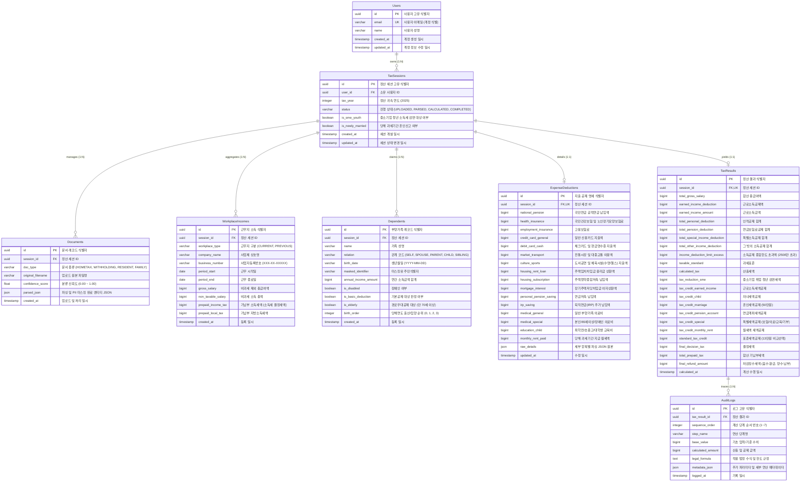

# [ERD] AI 셀프 연말정산 서비스 (SelfTax 2025) 데이터베이스 개체 관계 명세서

## 1. 개요 및 설계 원칙

본 문서는 **SelfTax 2025 (AI 셀프 연말정산 웹 서비스)**의 영속성 데이터 모델과 데이터베이스 아키텍처를 정의한 개체 관계 명세서(Entity Relationship Diagram)이다. 2025년 귀속 대한민국 개정 세법 및 개인정보보호법(PII)을 준수하며, SQLAlchemy 2.0 ORM 및 Alembic 마이그레이션을 통해 물리 DB에 적용되어 있다.

### 1.1 핵심 아키텍처 원칙
1. **고유식별정보(PII) 원본 영속화 원천 금지**:
   - 주민등록번호(RRN) 뒷자리 등 민감 개인식별정보는 인메모리 OCR 추출 시 즉시 정규식 마스킹(`[RRN Omitted]` 또는 생년월일 8자리 형태)되어 DB에 원본이 절대 저장되지 않는다.
2. **세션 기반 멀티 시나리오 모델링**:
   - 사용자는 귀속 연도(`tax_year`)별 복수의 정산 시나리오를 가질 수 있으며, 세션(`TaxSessions`)을 중심으로 모든 정산 데이터가 독립적으로 격리 및 관리된다.
3. **중도이직자 복수 근무지 정합성 지원**:
   - 연도 중 이직자의 주(현) 근무지와 1개 이상의 종(전) 근무지 원천징수 내역을 `WorkplaceIncomes` 테이블로 분리하여 1:N 집계 및 기납부세액(결정세액) 합산 연산을 지원한다.
4. **결정론적 세법 연산 감사 추적 (Audit Trail)**:
   - 2025 세법 규칙 기반의 7단계 산출 근거(기초값, 산출액, 법정 수식)를 `AuditLogs` 테이블에 시퀀스 단위로 영속화하여 결과 투명성과 재현성을 보장한다.
5. **플랫폼 이식성 (SQLite & PostgreSQL Dual Support)**:
   - 로컬 개발/테스트는 SQLite 3(Batch Alteration 모드), 상용 운영 환경은 PostgreSQL 15+를 완벽히 지원하도록 SQLAlchemy 2.0 정적 타입 힌트(`Mapped`, `mapped_column`)로 설계되었다.

---

## 2. Mermaid ERD 다이어그램

---

## 3. 공통 코드 (Enum) 정의

| Enum 명칭 | 값 (Values) | 설명 |
| :--- | :--- | :--- |
| **`TaxSessionStatus`** | `UPLOADED`, `PARSED`, `CALCULATED`, `COMPLETED` | 연말정산 세션의 생명주기 및 처리 단계 상태 |
| **`DocumentType`** | `HOMETAX`, `WITHHOLDING`, `RESIDENT`, `FAMILY` | 업로드 증빙 문서 유형 (홈택스 간소화, 원천징수영수증, 등본, 가족관계증명서) |
| **`WorkplaceType`** | `CURRENT`, `PREVIOUS` | 주(현) 근무지 및 종(전) 근무지 구분 |
| **`RelationType`** | `SELF`, `SPOUSE`, `PARENT`, `CHILD`, `SIBLING` | 본인 및 부양가족 법정 관계 구분 코드 |

---

## 4. 데이터 사전 및 테이블 명세서 (Data Dictionary)

### 4.1 `users` (사용자 계정 정보)
* **목적**: 시스템 접근 권한 및 개인 정산 시나리오를 소유하는 마스터 계정 엔티티
* **물리 테이블명**: `users`

| 컬럼명 | 논리명 | 데이터 타입 (SQLite/PG) | Null | 제약조건 | 기본값 | 설명 |
| :--- | :--- | :--- | :---: | :--- | :--- | :--- |
| `id` | 사용자 식별자 | UUID / CHAR(36) | N | PK | `uuid4()` | 사용자 고유 식별자 |
| `email` | 이메일 | VARCHAR(255) | N | UNIQUE, INDEX | - | 로그인 및 계정 식별 이메일 |
| `name` | 성명 | VARCHAR(100) | N | - | - | 근로자 성명 |
| `created_at` | 생성일시 | TIMESTAMP WITH TIME ZONE | N | - | `now()` | 계정 등록 일시 |
| `updated_at` | 수정일시 | TIMESTAMP WITH TIME ZONE | N | - | `now()` | 계정 정보 수정 일시 |

---

### 4.2 `tax_sessions` (연말정산 세션)
* **목적**: 사용자의 특정 과세연도 정산 입력값, 문서, 공제 및 결과를 격리 관리하는 핵심 세션
* **물리 테이블명**: `tax_sessions`

| 컬럼명 | 논리명 | 데이터 타입 | Null | 제약조건 | 기본값 | 설명 |
| :--- | :--- | :--- | :---: | :--- | :--- | :--- |
| `id` | 세션 식별자 | UUID / CHAR(36) | N | PK | `uuid4()` | 정산 세션 고유 식별자 |
| `user_id` | 소유자 식별자 | UUID / CHAR(36) | N | FK(`users.id`), INDEX | - | 소유 사용자 ID (CASCADE) |
| `tax_year` | 귀속 연도 | INTEGER | N | - | `2025` | 정산 대상 과세 연도 |
| `status` | 진행 상태 | VARCHAR(20) | N | Enum(`TaxSessionStatus`) | `'UPLOADED'` | 세션 진행 상태 |
| `is_sme_youth` | 중기감면 여부 | BOOLEAN | N | - | `FALSE` | 중소기업 청년 취업자 감면 대상 여부 |
| `is_newly_married` | 신혼부부 여부 | BOOLEAN | N | - | `FALSE` | 2024~2026 혼인신고 혼인세액공제(50만원) 대상 |
| `created_at` | 개설 일시 | TIMESTAMP WITH TIME ZONE | N | - | `now()` | 세션 최초 개설 일시 |
| `updated_at` | 변경 일시 | TIMESTAMP WITH TIME ZONE | N | - | `now()` | 세션 상태 최종 변경 일시 |

---

### 4.3 `documents` (업로드 증빙 문서)
* **목적**: 간소화 PDF, 종전근무지 원천징수영수증 등 업로드된 원본 메타데이터 및 OCR 파싱 결과 영속화
* **물리 테이블명**: `documents`

| 컬럼명 | 논리명 | 데이터 타입 | Null | 제약조건 | 기본값 | 설명 |
| :--- | :--- | :--- | :---: | :--- | :--- | :--- |
| `id` | 문서 식별자 | UUID / CHAR(36) | N | PK | `uuid4()` | 문서 고유 식별자 |
| `session_id` | 세션 식별자 | UUID / CHAR(36) | N | FK(`tax_sessions.id`), INDEX | - | 소속 세션 ID (CASCADE) |
| `doc_type` | 문서 종류 | VARCHAR(30) | N | Enum(`DocumentType`) | - | 문서 자동 분류 결과 |
| `original_filename`| 파일명 | VARCHAR(255) | N | - | - | 사용자가 업로드한 원본 파일명 |
| `confidence_score` | 분류 신뢰도 | FLOAT | Y | - | `1.0` | 분류 모델 신뢰도 점수 (0.00 ~ 1.00) |
| `parsed_json` | 파싱 JSON | JSON / JSONB | Y | - | `NULL` | 민감정보 마스킹 완료된 파싱 구조체 |
| `created_at` | 업로드 일시 | TIMESTAMP WITH TIME ZONE | N | - | `now()` | 파일 업로드 및 분석 완료 일시 |

---

### 4.4 `workplace_incomes` (근무지별 근로소득 및 기납부세액)
* **목적**: 주(현) 근무지 및 복수 종(전) 근무지의 급여 총액과 원천징수(기납부) 세액 집계
* **물리 테이블명**: `workplace_incomes`

| 컬럼명 | 논리명 | 데이터 타입 | Null | 제약조건 | 기본값 | 설명 |
| :--- | :--- | :--- | :---: | :--- | :--- | :--- |
| `id` | 근무지 레코드 ID | UUID / CHAR(36) | N | PK | `uuid4()` | 근무지 소득 고유 식별자 |
| `session_id` | 세션 식별자 | UUID / CHAR(36) | N | FK(`tax_sessions.id`), INDEX | - | 소속 세션 ID (CASCADE) |
| `workplace_type` | 근무지 구분 | VARCHAR(20) | N | Enum(`WorkplaceType`) | - | 주(현) 근무지 / 종(전) 근무지 구분 |
| `company_name` | 사업체 상호명 | VARCHAR(200) | N | - | - | 회사명 |
| `business_number` | 사업자등록번호 | VARCHAR(20) | Y | - | `NULL` | 사업자등록번호 (XXX-XX-XXXXX) |
| `period_start` | 근무 시작일 | DATE | Y | - | `NULL` | 귀속기간 근무 시작일 |
| `period_end` | 근무 종료일 | DATE | Y | - | `NULL` | 귀속기간 근무 종료일 |
| `gross_salary` | 비과세 제외 총급여 | BIGINT | N | - | `0` | 과세 대상 총급여액 |
| `non_taxable_salary`| 비과세 소득 총액 | BIGINT | N | - | `0` | 식대, 자가운전 등 비과세 소득 |
| `prepaid_income_tax`| 기납부 소득세 | BIGINT | N | - | `0` | 소득세 기납부액 (종전지는 결정세액) |
| `prepaid_local_tax` | 기납부 지방소득세 | BIGINT | N | - | `0` | 지방소득세 기납부액 |
| `created_at` | 생성 일시 | TIMESTAMP WITH TIME ZONE | N | - | `now()` | 레코드 등록 일시 |

---

### 4.5 `dependents` (부양가족 및 인적공제)
* **목적**: 본인 및 부양가족 인적공제 요건 판정 및 가계 구성원 영속화
* **물리 테이블명**: `dependents`

| 컬럼명 | 논리명 | 데이터 타입 | Null | 제약조건 | 기본값 | 설명 |
| :--- | :--- | :--- | :---: | :--- | :--- | :--- |
| `id` | 부양가족 ID | UUID / CHAR(36) | N | PK | `uuid4()` | 부양가족 고유 식별자 |
| `session_id` | 세션 식별자 | UUID / CHAR(36) | N | FK(`tax_sessions.id`), INDEX | - | 소속 세션 ID (CASCADE) |
| `name` | 가족 성명 | VARCHAR(100) | N | - | - | 성명 |
| `relation` | 관계 코드 | VARCHAR(20) | N | Enum(`RelationType`) | - | 관계 (SELF, SPOUSE, PARENT, CHILD, SIBLING) |
| `birth_date` | 생년월일 | VARCHAR(20) | Y | - | `NULL` | 생년월일 문자열 (`YYYY-MM-DD`) |
| `masked_identifier`| 마스킹 식별자 | VARCHAR(50) | Y | - | `NULL` | PII 마스킹 식별문자열 (`YYMMDD-1******`) |
| `annual_income_amount`| 연간 소득금액 | BIGINT | N | - | `0` | 연간 소득금액 합계 (기준: 100만원 이하) |
| `is_disabled` | 장애인 여부 | BOOLEAN | N | - | `FALSE` | 장애인 추가공제(200만원) 대상 여부 |
| `is_basic_deduction`| 기본공제 대상 | BOOLEAN | N | - | `TRUE` | 나이/소득 요건 충족 기본공제 여부 |
| `is_elderly` | 경로우대 대상 | BOOLEAN | N | - | `FALSE` | 만 70세 이상 경로우대(100만원) 대상 |
| `birth_order` | 출산입양 순위 | INTEGER | N | - | `0` | 당해연도 출산/입양 순위 (1:첫째, 2:둘째, 3:셋째이상) |
| `created_at` | 생성 일시 | TIMESTAMP WITH TIME ZONE | N | - | `now()` | 레코드 등록 일시 |

---

### 4.6 `expense_deductions` (소득 및 세액공제 지출 명세)
* **목적**: 간소화 서비스 파싱 및 사용자 직접 입력 기반의 공제 항목별 지출 금액 보관 (1 세션 당 1 레코드)
* **물리 테이블명**: `expense_deductions`

| 컬럼명 | 논리명 | 데이터 타입 | Null | 제약조건 | 기본값 | 설명 |
| :--- | :--- | :--- | :---: | :--- | :--- | :--- |
| `id` | 공제 명세 ID | UUID / CHAR(36) | N | PK | `uuid4()` | 공제 명세 고유 식별자 |
| `session_id` | 세션 식별자 | UUID / CHAR(36) | N | FK(`tax_sessions.id`), UNIQUE, INDEX | - | 소속 세션 ID (1:1 관계, CASCADE) |
| `national_pension` | 국민연금 | BIGINT | N | - | `0` | 공적연금 납입액 (전액 소득공제) |
| `health_insurance` | 건강보험료 | BIGINT | N | - | `0` | 건보 및 노인장기요양보험료 |
| `employment_insurance`| 고용보험료 | BIGINT | N | - | `0` | 고용보험료 납입액 |
| `credit_card_general` | 일반 신용카드 | BIGINT | N | - | `0` | 일반 가맹점 신용카드 지출액 (15%) |
| `debit_card_cash` | 직불/현금영수증 | BIGINT | N | - | `0` | 체크카드/현금영수증 지출액 (30%) |
| `market_transport` | 전통시장/대중교통 | BIGINT | N | - | `0` | 전통시장 및 대중교통 이용액 (40%) |
| `culture_sports` | 도서/체육시설 | BIGINT | N | - | `0` | 2025 개정: 헬스장/수영장 포함 30% |
| `housing_rent_loan` | 임차차입금 | BIGINT | N | - | `0` | 주택임차차입금 원리금 상환액 |
| `housing_subscription`| 청약저축 | BIGINT | N | - | `0` | 주택청약종합저축 (2025 한도 300만원) |
| `mortgage_interest` | 장기주택저당이자 | BIGINT | N | - | `0` | 장기주택저당차입금 이자상환액 |
| `personal_pension_saving`| 연금저축 | BIGINT | N | - | `0` | 개인 연금저축 납입액 (한도 600만원) |
| `irp_saving` | 퇴직연금(IRP) | BIGINT | N | - | `0` | IRP 추가 납입액 (연금저축 합산 900만원) |
| `medical_general` | 일반 의료비 | BIGINT | N | - | `0` | 부양가족 일반 의료비 (한도 700만원) |
| `medical_special` | 특정 의료비 | BIGINT | N | - | `0` | 본인/65세이상/장애인/난임/미숙아 의료비 (한도 없음) |
| `education_child` | 교육비 지출 | BIGINT | N | - | `0` | 취학전아동/초중고/대학생 교육비 |
| `monthly_rent_paid` | 지급 월세액 | BIGINT | N | - | `0` | 월세액 (2025 한도 1,000만원) |
| `raw_details` | 세부 파싱 JSON | JSON / JSONB | Y | - | `NULL` | 홈택스 세부 분류 및 추가 지출 상세 내역 |
| `updated_at` | 최종 수정일시 | TIMESTAMP WITH TIME ZONE | N | - | `now()` | 공제 명세 갱신 일시 |

---

### 4.7 `tax_results` (최종 세액 정산 결과)
* **목적**: 2025 세법 산출 알고리즘 수행 결과인 과세표준, 산출세액, 세액공제 합계 및 최종 환급/추가납부 세액 영속화
* **물리 테이블명**: `tax_results`

| 컬럼명 | 논리명 | 데이터 타입 | Null | 제약조건 | 기본값 | 설명 |
| :--- | :--- | :--- | :---: | :--- | :--- | :--- |
| `id` | 결과 레코드 ID | UUID / CHAR(36) | N | PK | `uuid4()` | 결과 고유 식별자 |
| `session_id` | 세션 식별자 | UUID / CHAR(36) | N | FK(`tax_sessions.id`), UNIQUE, INDEX | - | 소속 세션 ID (1:1 관계, CASCADE) |
| `total_gross_salary` | 총급여 합계 | BIGINT | N | - | `0` | 주+종 근무지 과세급여 합산 |
| `earned_income_deduction`| 근로소득공제 | BIGINT | N | - | `0` | 5단계 법정 근로소득공제액 |
| `earned_income_amount` | 근로소득금액 | BIGINT | N | - | `0` | 총급여 - 근로소득공제 |
| `total_personal_deduction`| 인적공제 합계 | BIGINT | N | - | `0` | 기본공제 + 추가공제 |
| `total_pension_deduction` | 연금보험료공제 | BIGINT | N | - | `0` | 국민연금 납입액 합계 |
| `total_special_income_deduction`| 특별소득공제 | BIGINT | N | - | `0` | 건보+고용+주택자금 소득공제 |
| `total_other_income_deduction` | 그밖의 소득공제| BIGINT | N | - | `0` | 신용카드 공제, 청약저축 등 |
| `income_deduction_limit_excess`| 소득공제 한도초과| BIGINT | N | - | `0` | 특별+기타 소득공제 2,500만원 초과분 |
| `taxable_standard` | 과세표준 | BIGINT | N | - | `0` | 소득금액 - 종합소득공제 |
| `calculated_tax` | 산출세액 | BIGINT | N | - | `0` | 과세표준 8단계 누진세율 적용액 |
| `tax_reduction_sme` | 중기감면세액 | BIGINT | N | - | `0` | 중소기업 청년 감면 (한도 200만원) |
| `tax_credit_earned_income`| 근로소득세액공제| BIGINT | N | - | `0` | 산출세액 기준 법정 공제 |
| `tax_credit_child` | 자녀세액공제 | BIGINT | N | - | `0` | 2025 개정 확대 자녀세액공제 |
| `tax_credit_marriage` | 혼인세액공제 | BIGINT | N | - | `0` | 2024~2026 혼인신고 50만원 정액 |
| `tax_credit_pension_account`| 연금계좌세액공제| BIGINT | N | - | `0` | 연금저축/IRP 납입액 12%~15% |
| `tax_credit_special` | 특별세액공제 | BIGINT | N | - | `0` | 보장성보험+의료비+교육비+기부금 |
| `tax_credit_monthly_rent`| 월세액 세액공제 | BIGINT | N | - | `0` | 총급여 기준 15%~17% 세액공제 |
| `standard_tax_credit`| 표준세액공제 | BIGINT | N | - | `0` | 특별공제 미신청 시 비교 적용 (13만원) |
| `final_decision_tax` | 결정세액 | BIGINT | N | - | `0` | 산출세액 - 세액감면/공제 합계 |
| `total_prepaid_tax` | 기납부세액 합계 | BIGINT | N | - | `0` | 주+종 근무지 기납부 소득세 합산 |
| `final_refund_amount`| 차감징수세액 | BIGINT | N | - | `0` | 결정세액 - 기납부세액 (음수:환급, 양수:납부) |
| `calculated_at` | 계산 일시 | TIMESTAMP WITH TIME ZONE | N | - | `now()` | 세법 계산 완료 시각 |

---

### 4.8 `audit_logs` (세법 계산 근거 및 감사 추적)
* **목적**: 2025 세법 계산 엔진의 7개 단계별 연산 과정, 적용 법조문, 기준치, 결과치를 영속화하여 감사 가능성(Auditability) 확보
* **물리 테이블명**: `audit_logs`

| 컬럼명 | 논리명 | 데이터 타입 | Null | 제약조건 | 기본값 | 설명 |
| :--- | :--- | :--- | :---: | :--- | :--- | :--- |
| `id` | 로그 ID | UUID / CHAR(36) | N | PK | `uuid4()` | 로그 고유 식별자 |
| `tax_result_id` | 정산 결과 ID | UUID / CHAR(36) | N | FK(`tax_results.id`), INDEX | - | 소속 정산 결과 ID (CASCADE) |
| `sequence_order`| 계산 순서 번호 | INTEGER | N | - | - | 연산 시퀀스 번호 (1:근로소득공제 ~ 7:차감징수세액) |
| `step_name` | 단계명 | VARCHAR(100) | N | - | - | 계산 단계 명칭 |
| `base_value` | 기초 기준값 | BIGINT | Y | - | `0` | 해당 연산의 입력/기준 금액 |
| `calculated_amount`| 산출 금액 | BIGINT | Y | - | `0` | 단계별 공제 또는 세액 산출 결과치 |
| `legal_formula` | 법정 수식 | TEXT | Y | - | `NULL` | 적용된 세법 조항 및 산출 공식 설명 |
| `metadata_json` | 세부 메타데이터 | JSON / JSONB | Y | - | `NULL` | 한도 초과 절사 내역, 적용 세율 등 세부 파라미터 |
| `logged_at` | 기록 일시 | TIMESTAMP WITH TIME ZONE | N | - | `now()` | 감사 레코드 기록 시각 |

---

## 5. 데이터 무결성 및 인덱스 설계

### 5.1 인덱스 (Index) 명세
| 테이블명 | 인덱스 명칭 | 대상 컬럼 | 인덱스 유형 | 목적 |
| :--- | :--- | :--- | :--- | :--- |
| `users` | `ix_users_email` | `email` | UNIQUE | 로그인 및 계정 중복 방지 고속 검색 |
| `tax_sessions` | `ix_tax_sessions_user_id` | `user_id` | Non-Unique B-Tree | 특정 사용자의 세션 목록 조회 성능 확보 |
| `documents` | `ix_documents_session_id` | `session_id` | Non-Unique B-Tree | 특정 세션에 업로드된 문서 목록 조회 |
| `workplace_incomes` | `ix_workplace_incomes_session_id` | `session_id` | Non-Unique B-Tree | 특정 세션의 주/종 근무지 소득 집계 |
| `dependents` | `ix_dependents_session_id` | `session_id` | Non-Unique B-Tree | 특정 세션의 부양가족 명단 조회 |
| `expense_deductions`| `ix_expense_deductions_session_id`| `session_id` | UNIQUE | 세션 당 1개의 지출 공제 레코드 보장 |
| `tax_results` | `ix_tax_results_session_id` | `session_id` | UNIQUE | 세션 당 1개의 최종 산출 결과 보장 |
| `audit_logs` | `ix_audit_logs_tax_result_id` | `tax_result_id` | Non-Unique B-Tree | 결과 리포트용 단계별 감사 로그 고속 정렬 조회 |

### 5.2 외래키 무결성 및 CASCADE 전파 규칙
1. **User 삭제 시**: 하위의 모든 `TaxSessions`가 연쇄 삭제(`ON DELETE CASCADE`)된다.
2. **TaxSession 삭제 시**:
   - 하위 `Documents`, `WorkplaceIncomes`, `Dependents`, `ExpenseDeductions`, `TaxResults`가 모두 즉시 연쇄 삭제된다.
3. **TaxResult 삭제 또는 재계산 시**:
   - 하위의 모든 `AuditLogs`가 연쇄 삭제(`ON DELETE CASCADE`)되어 오래된 감사 이력이 남지 않고 새로 생성된 로그로 대체된다.

---

## 6. 마이그레이션 이력 (Alembic)

* **현재 Revision ID**: `51c06686ed07`
* **마이그레이션 모듈**: `alembic/versions/51c06686ed07_create_erd_v1_tables.py`
* **환경 특이사항**:
  - SQLite의 외래키 및 제약조건 변경 지원을 위해 `render_as_batch=True` 옵션이 활성화되어 있으며, PostgreSQL 배포 시에도 스키마 충돌 없이 완벽히 동작하도록 DDL이 구성되어 있다.
