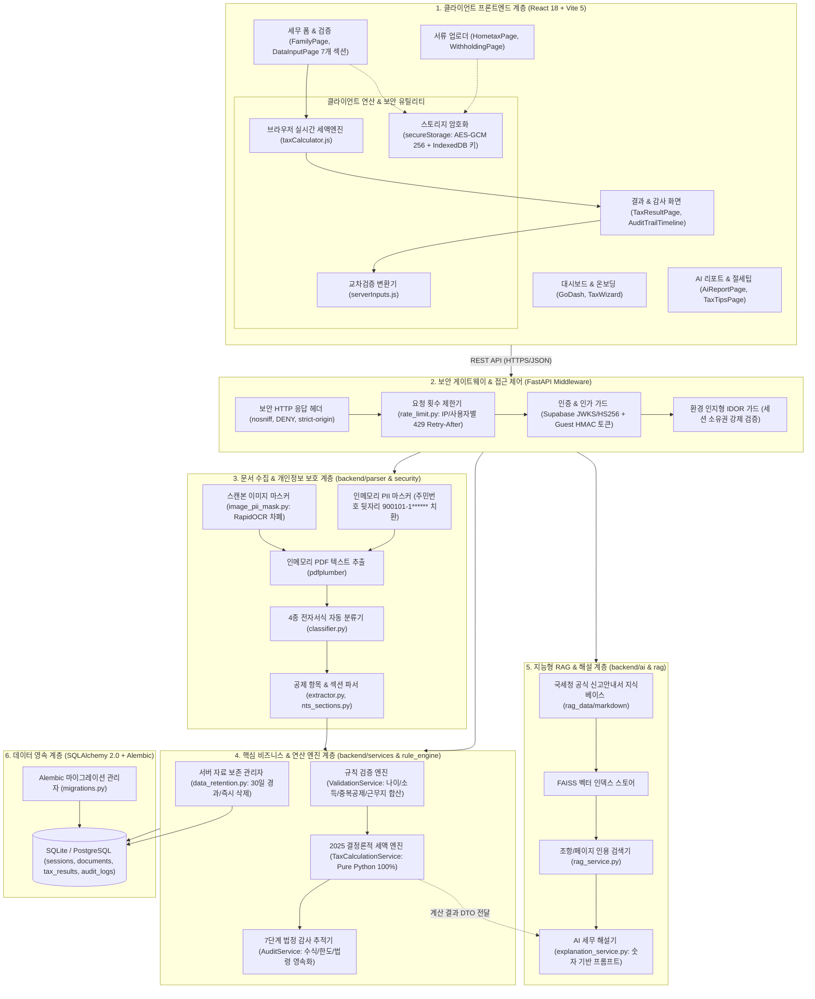
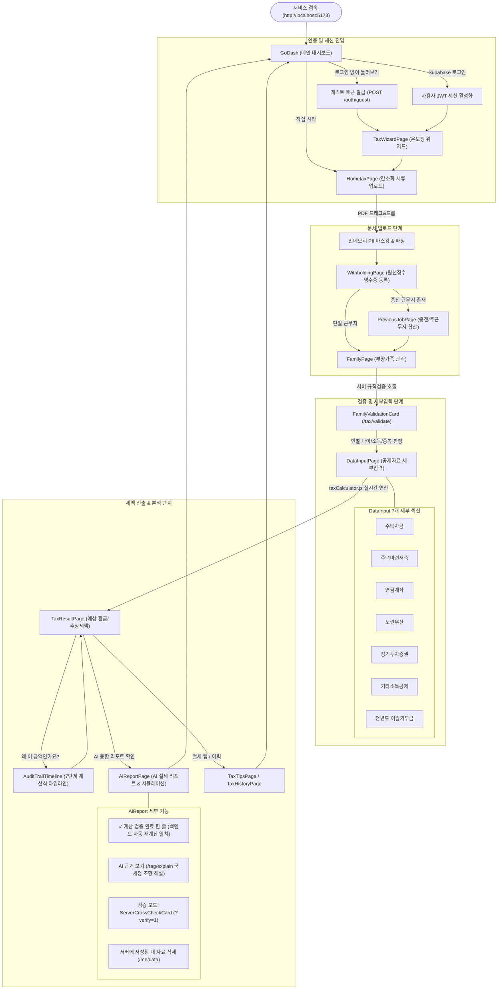
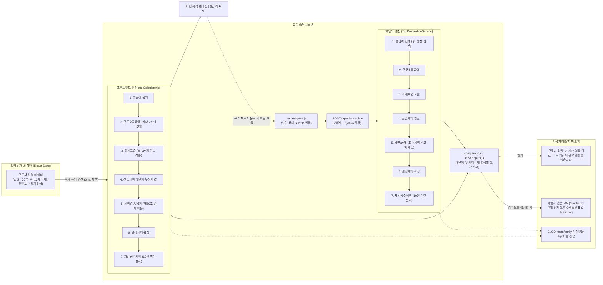
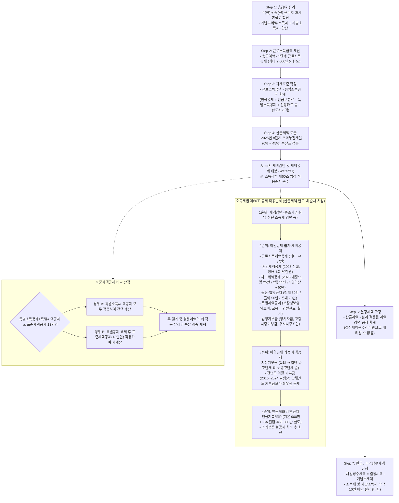
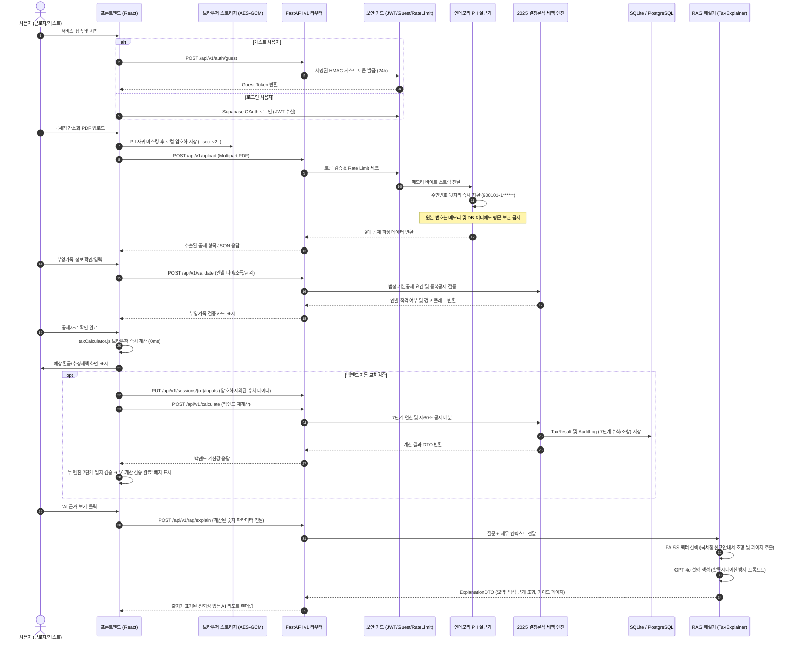
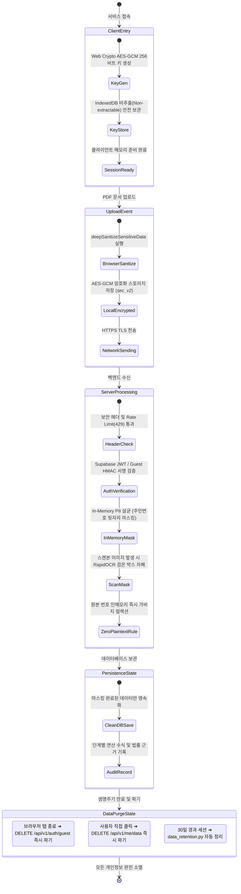
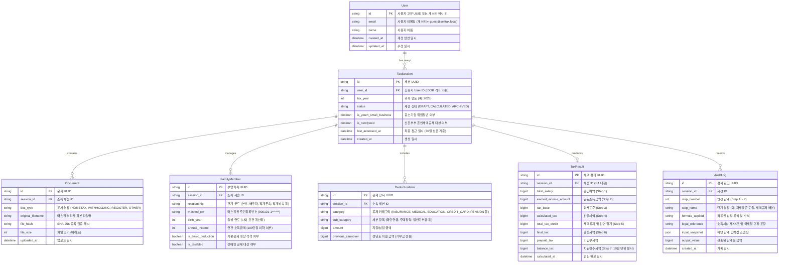

# 📊 정산봄(JeongsanBom) AI 셀프 연말정산 시스템 Mermaid 다이어그램 명세서

본 문서는 **정산봄(SelfTax 2025) AI 셀프 연말정산 서비스**의 현재 코드베이스와 기술 구현을 정밀 분석하여 작성된 통합 Mermaid 다이어그램 모음입니다.

---

## 📑 목차
1. [전체 시스템 아키텍처 및 계층 다이어그램 (System Architecture)](#1-전체-시스템-아키텍처-및-계층-다이어그램)
2. [사용자 여정 및 화면 네비게이션 전이도 (User Journey & Screen Navigation)](#2-사용자-여정-및-화면-네비게이션-전이도)
3. [듀얼 세액 엔진 교차검증 & Parity 아키텍처 (Dual Engine & Cross-Check)](#3-듀얼-세액-엔진-교차검증--parity-아키텍처)
4. [2025 결정론적 세액 엔진 7단계 및 공제 배분 폭포수 (Tax Engine Waterfall)](#4-2025-결정론적-세액-엔진-7단계-및-공제-배분-폭포수)
5. [엔드투엔드 데이터 처리 & RAG 질의 시퀀스 (End-to-End Sequence)](#5-엔드투엔드-데이터-처리--rag-질의-시퀀스)
6. [보안, PII 보호 및 세션 라이프사이클 상태도 (Security & Lifecycle)](#6-보안-pii-보호-및-세션-라이프사이클-상태도)
7. [데이터베이스 엔티티 관계도 (Database ERD)](#7-데이터베이스-엔티티-관계도)

---

## 1. 전체 시스템 아키텍처 및 계층 다이어그램

정산봄은 클라이언트 브라우저 실시간 엔진과 백엔드 Python 결정론적 엔진이 상호 보완하며, 강력한 인메모리 PII 마스킹과 국세청 공문서 RAG가 결합된 5계층 아키텍처를 가집니다.

---

## 2. 사용자 여정 및 화면 네비게이션 전이도

사용자(근로자/게스트)가 서비스에 접속하여 연말정산을 완료하고 AI 리포트 및 감사 추적을 확인하기까지의 7단계 화면 흐름도입니다.

---

## 3. 듀얼 세액 엔진 교차검증 & Parity 아키텍처

프론트엔드(`taxCalculator.js`)와 백엔드(`tax_engine.py`)가 독립적으로 구현되어 상호 교차검증(Dual-Engine Verification)을 수행하는 고신뢰성 아키텍처입니다.

---

## 4. 2025 결정론적 세액 엔진 7단계 및 공제 배분 폭포수

대한민국 소득세법 제60조(세액감면 및 세액공제의 적용순서)와 2025년 개정 세법(신혼부부, 자녀, 연금 ISA 확대)을 준수하는 연산 파이프라인입니다.

---

## 5. 엔드투엔드 데이터 처리 & RAG 질의 시퀀스

사용자 브라우저, FastAPI 보안 라우터, 인메모리 살균기, 세액 엔진 및 RAG 서비스 간의 전체 통신 시퀀스입니다.

---

## 6. 보안, PII 보호 및 세션 라이프사이클 상태도

민감 개인정보(주민등록번호 등)가 시스템에 유입되어 마스킹되고 소멸하기까지의 무평문(Zero-Plaintext) 보안 라이프사이클입니다.

---

## 7. 데이터베이스 엔티티 관계도

SQLAlchemy 2.0 모델 및 Alembic 마이그레이션으로 관리되는 데이터베이스 핵심 스키마 관계도(ERD)입니다.

---

## 📌 요약 및 특징

1. **최신 코드베이스 100% 동기화**: `taxCalculator.js`와 백엔드 세액 엔진의 듀얼 검증 체계, 소득세법 제60조 배분 순서, 2025 개정 세법(신혼부부, 자녀, 연금 ISA), Web Crypto AES-GCM 스토리지 암호화, 게스트 토큰 라이프사이클을 모두 망라했습니다.
2. **무할루시네이션(Zero-Hallucination) 원칙 시각화**: 세액 계산에는 LLM을 배제하고 Pure Python 및 JS 공식으로 연산하며, AI는 국세청 공문서 RAG 기반의 근거 조항 해설에만 제한 적용됨을 다이어그램으로 명확히 규정했습니다.
3. **무평문(Zero-Plaintext) 보안 준수**: 클라이언트 브라우저, 네트워크 전송, 서버 인메모리, 데이터베이스 영속화에 이르는 전 구간 개인식별정보(PII) 마스킹 처리 흐름을 도식화했습니다.
