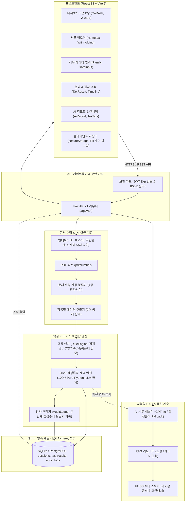
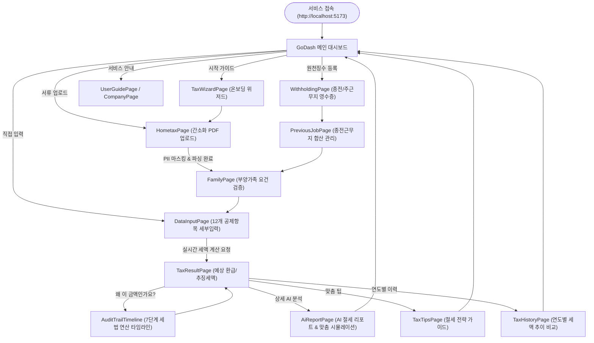
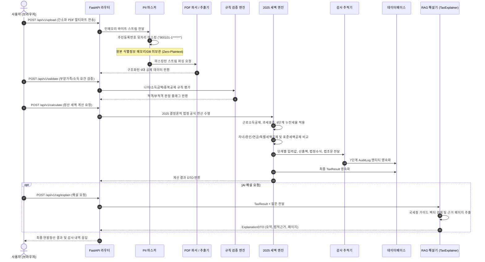
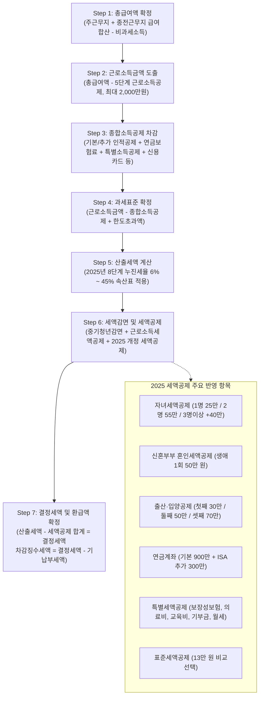
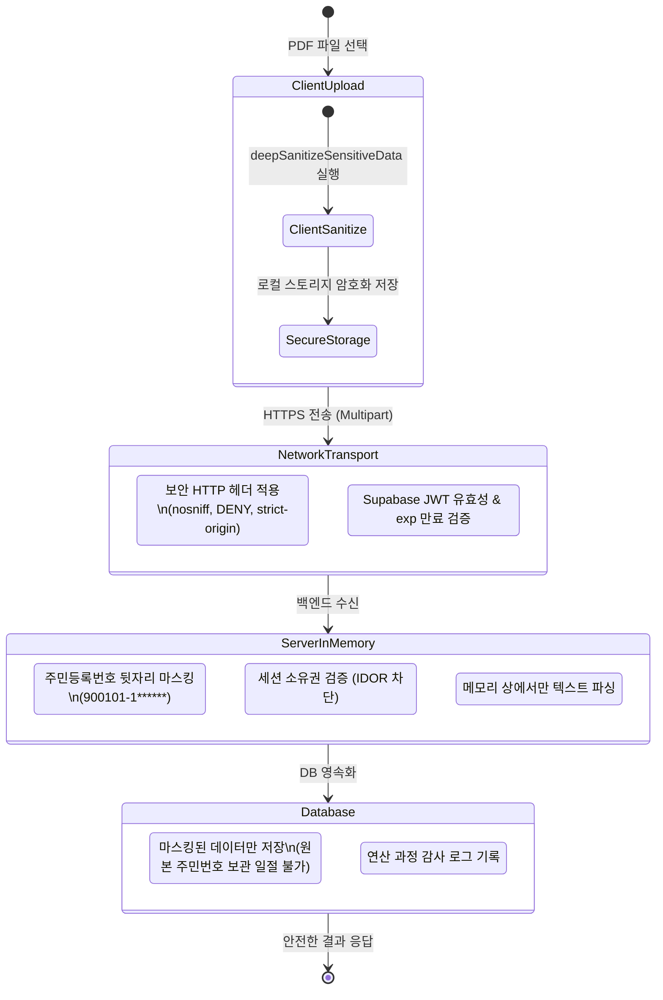

# 정산봄 (SelfTax 2025) 시스템 다이어그램 명세서

본 문서는 **정산봄 AI 셀프 연말정산 서비스**의 아키텍처, 데이터 파이프라인, 사용자 화면 네비게이션, 세액 연산 엔진 및 보안 라이프사이클을 표현한 Mermaid 다이어그램 모음입니다.

---

## 1. 전체 시스템 아키텍처 (System Architecture)

프론트엔드(React/Vite), 백엔드(FastAPI), 코어 엔진 계층(규칙 엔진, 세액 계산기, 감사 추적기, RAG) 및 데이터 저장소 간의 계층형 아키텍처입니다.

---

## 2. 사용자 여정 및 화면 네비게이션 플로우 (User Journey & Navigation Flow)

사용자가 서비스에 진입하여 서류 업로드, 데이터 검증, 세액 계산, 감사 추적 및 AI 리포트를 확인하는 전체 화면 전이도입니다.

---

## 3. 엔드투엔드 데이터 처리 파이프라인 (Data Pipeline)

홈택스 PDF 업로드부터 인메모리 개인정보 살균, 결정론적 세액 연산, 감사 로그 DB 기록 및 RAG 연계 해설까지의 처리 순서도입니다.

---

## 4. 2025 결정론적 세액 엔진 7단계 연산 흐름도 (7-Step Tax Engine Flow)

대한민국 소득세법 및 2025년 개정 세법에 맞춘 결정론적(Zero-Hallucination) 세액 연산 파이프라인입니다.

---

## 5. 보안 및 PII 보호 라이프사이클 (Security & Compliance Lifecycle)

클라이언트부터 서버, DB에 이르는 개인정보 보호 및 접근 제어 파이프라인입니다.

